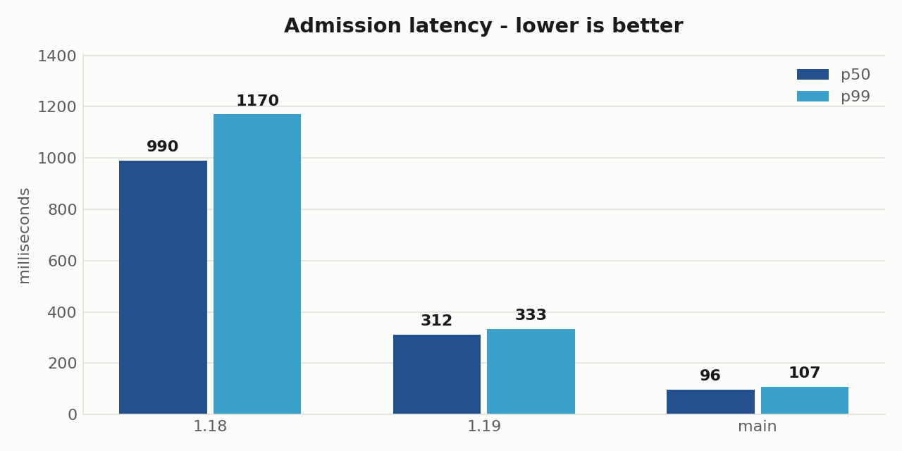
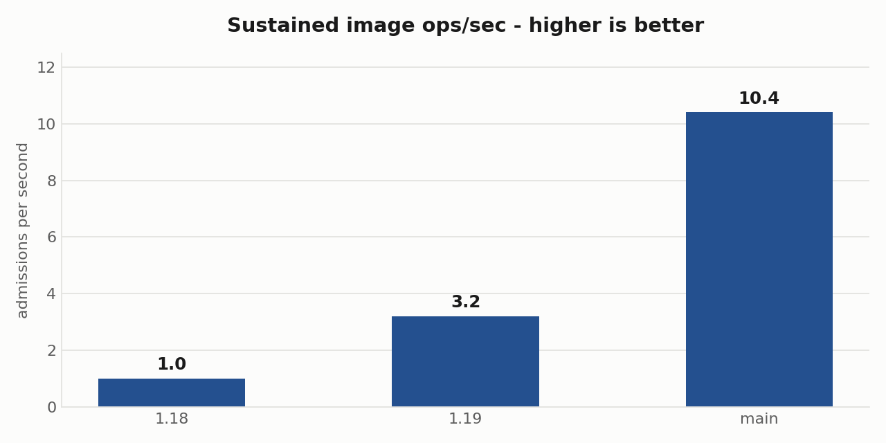
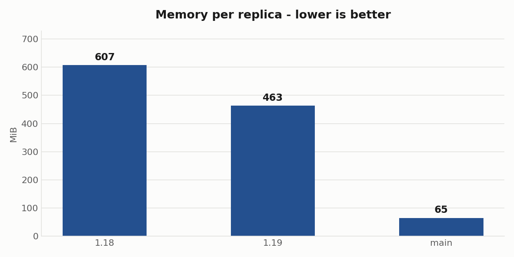
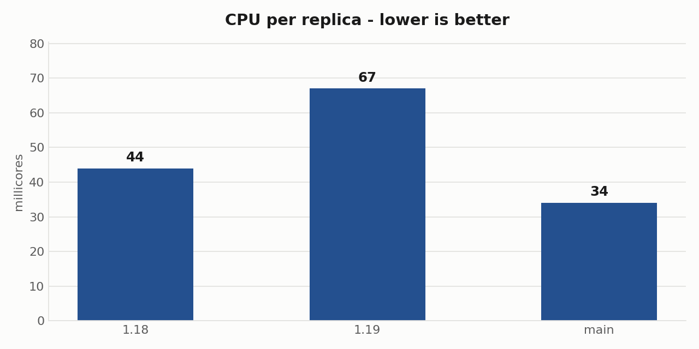
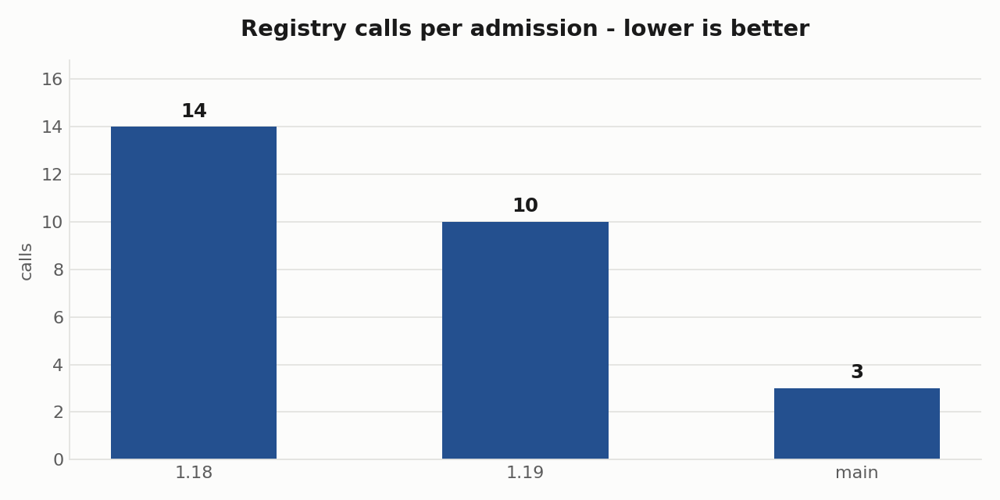
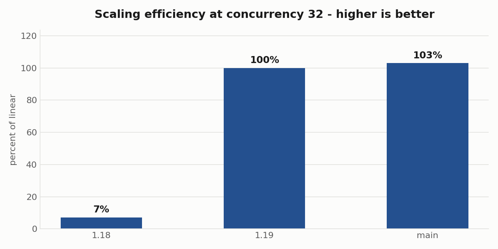

# Kyverno image verification: slide numbers

## Environment

| | |
|---|---|
| Host | MacBook (Apple silicon, 12 cores), Docker Desktop |
| Cluster | KinD v1.31.6, 1 control plane + 3 workers |
| Scheduling | KWOK fake nodes — pods are admitted and scheduled but never pulled, so only Kyverno's own registry traffic is measured |
| Registry | zot (OCI 1.1, Referrers API), in-cluster |
| Network | TLS proxy in front of the registry injecting a fixed 25 ms delay per request |
| Kyverno | Helm chart 3.8.2 (1.18.2), 3.9.1 (1.19.1 and main) |
| main | `ghcr.io/kyverno/kyverno@sha256:f4dfde2e1680…`, built from commit `338fbd1a2` |

Each version gets a freshly built cluster. Nothing is shared between versions.

## Harness

| | |
|---|---|
| Driver | k6, `constant-vus` executor |
| Workload | Create a Pod carrying 1 signed image, repeatedly, for 120 s |
| Images | `FROM scratch`, signed offline with a local cosign key |
| Policy | One `ImageValidatingPolicy`, one cosign key attestor, `failurePolicy: Fail`, `validationActions: [Deny]` |
| Cache | **Verification cache enabled** on all three versions (`--imageVerifyCacheEnabled=true`, verified on the running Deployment) |
| Config | Kyverno defaults otherwise |

### What the harness checks before it trusts a cell

- An unsigned image must be **denied** and a correctly signed image **admitted**, before and after every cell. This catches a webhook that is not actually on the admission path.
- Each admission must reach the registry, confirming the controller is doing the work rather than passing requests through.
- Pod restarts are counted per cell; any restart invalidates it.
- Any cell above a 1% failure rate is discarded — a failed admission is faster than a real one, so including them would flatter the result.

## The table

All three versions, identical policy, identical load, cache enabled.

| Metric | Kyverno 1.18 | Kyverno 1.19 | main (1.20-dev) |
|---|---|---|---|
| **Admission latency p50 / p99** | 990 / 1170 ms | 312 / 333 ms | **96 / 107 ms** |
| **Sustained image ops/sec** | 1.0 | 3.2 | **10.4** |
| **Verification cache** | present, but **not used by ImageValidatingPolicy** — it serves only the legacy ClusterPolicy image rules | enabled; signature checks served from cache | enabled; signature checks served from cache |
| **CPU / memory per replica** | 44 mC / 607 MiB | 67 mC / 463 MiB | **34 mC / 65 MiB** |

Registry calls per admission: **14 → 10 → 3**.

### At a glance

Charts regenerate from `charts/make-charts.py`.

CPU is the one row that does not fall in a straight line: 1.19 costs more CPU per
replica than 1.18 while doing three times the work, so read it against the
throughput chart rather than on its own.

**On the cache row.** No hit-rate percentage is quoted, because it would say more
about the workload than the engine. This benchmark admits one of four images
repeatedly, so after the first verification of each, everything hits: main logged
3,820 hits against 3,824 checks, and the 4 misses are exactly the 4 distinct
images. Any working cache scores ~99.9% on that shape, and a workload with
thousands of distinct images would score far lower. What separates the versions
is the registry traffic that survives the cache — 14, 10, and 3 calls per
admission.

### Throughput under concurrency

Measured separately by ramping concurrency from 1 to 32 and finding where throughput stops responding.

| | Kyverno 1.18 | Kyverno 1.19 | main |
|---|---|---|---|
| Peak admissions/sec | 2.0 | 201.8 | 92.5 |
| Stops scaling at | **concurrency 2** | no ceiling found | no ceiling found |
| Scaling efficiency | **7% of linear** | 100% | 103% |

1.18 stops converting concurrency into throughput at 2 and gets slower past 4 — while returning zero errors. 1.19 and main both stayed near-linear to the top step, so their ceiling is above what one laptop can drive.

## Reading the numbers

- **Milliseconds are this laptop.** Registry call counts and the version-to-version ratios travel; absolute wall-clock does not.
- The **25 ms registry delay is a chosen input**, not a measurement of any real registry.
- Latency, throughput, cache and resource rows are single runs. The concurrency table is two rounds. Registry call counts have been identical across every repeat.
- 1.18.2 runs a textually different policy because 1.18 rejects a `ctlog` block without a `url`. Same key, same images, same expression.
